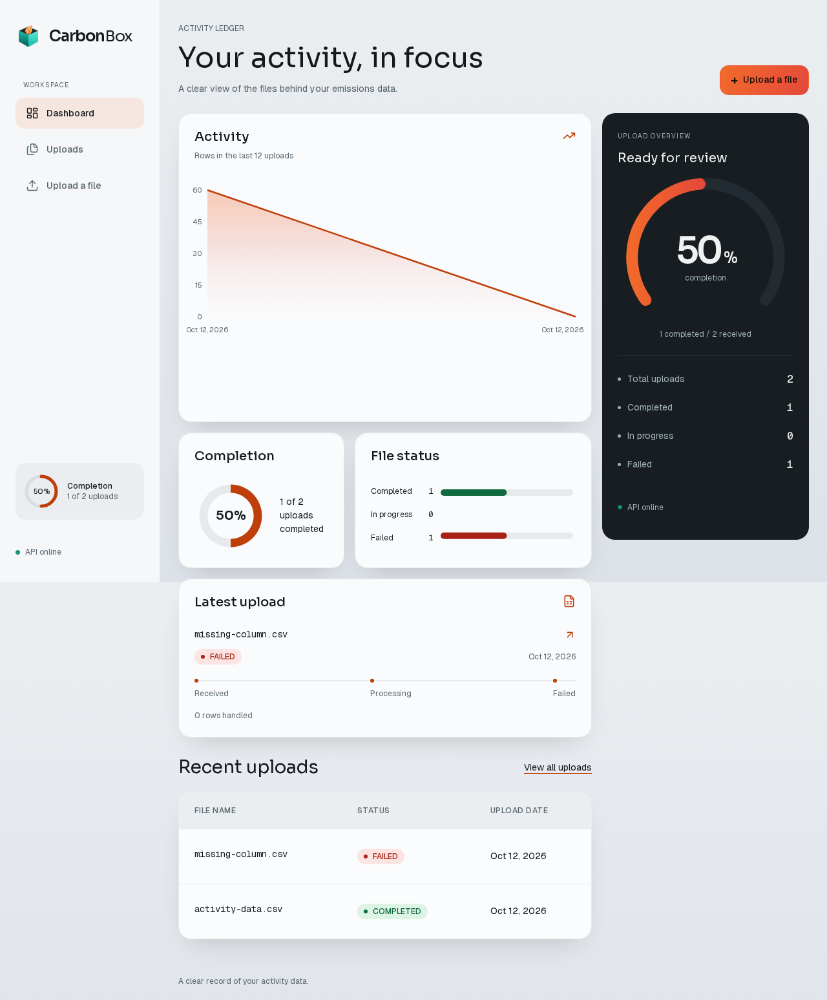
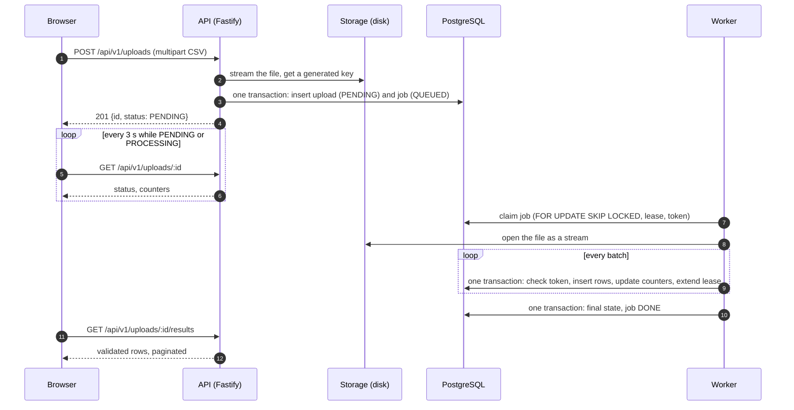
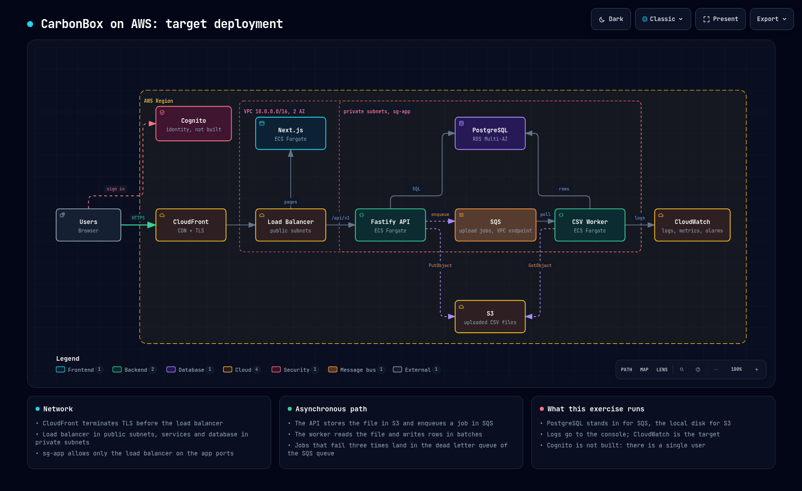

# CarbonBox: asynchronous CSV processing

Upload a CSV of activity data, watch it being processed in the background and read the validated rows.
Built for the CarbonBox full stack exercise: Fastify, Prisma and PostgreSQL on the back end; Next.js (App Router),
React Query, Axios and Tailwind on the front end; Docker Compose for the whole stack.



- Architecture diagram on AWS (target deployment): [`docs/arquitectura-aws.png`](docs/arquitectura-aws.png), interactive version [`docs/arquitectura-aws.html`](docs/arquitectura-aws.html)
- API reference (OpenAPI, generated from the routes): `http://localhost:3001/docs` when the stack runs
- How AI was used, honestly: [`USO-DE-IA.md`](USO-DE-IA.md)
- Operations runbook: [`docs/operations.md`](docs/operations.md). Measured performance: [`docs/performance.md`](docs/performance.md)
- Per module working notes: [`docs/ai-log.md`](docs/ai-log.md) and the specifications in [`openspec/specs`](openspec/specs)

## Contents

1. [What it does](#what-it-does)
2. [Requirements](#requirements)
3. [Run it](#run-it)
4. [Try it](#try-it)
5. [Architecture](#architecture)
6. [Production readiness](#production-readiness)
7. [Technical decisions](#technical-decisions)
8. [Known limitations](#known-limitations)
9. [Tests and quality](#tests-and-quality)
10. [Project layout](#project-layout)

## What it does

1. A user chooses a `.csv` file in the browser. The page validates the name, size and emptiness and uploads it with a progress bar.
2. The API stores the file, creates an `Upload` in state `PENDING` and a job for it in one database transaction, and answers `201`.
3. A separate worker process claims the job, streams the file, validates every row and stores the valid rows in batches.
4. The detail page polls every three seconds and shows the state until the upload is `COMPLETED` or `FAILED`, then the rows and any rejected lines.

Row rules: `category` and `unit` are not empty, `amount` is a plain decimal greater than zero, `date` is a real calendar date written `YYYY-MM-DD`.
A file with some bad rows is `COMPLETED` with the rejected lines listed. A file with a wrong header, no valid row or broken quoting is `FAILED` with the reason.

## Requirements

- Docker with Compose. That is all the one command path needs.
- Free ports 3000 (web) and 3001 (API). PostgreSQL is not published to the host, so a local server on 5432 does not conflict.
- For the developer path only: Node.js 20.9 or newer (developed on 26) and [Bun](https://bun.sh) 1.3.

## Run it

```bash
docker compose up --build
```

Open `http://localhost:3000`. API readiness is at `http://localhost:3001/health/ready` and the OpenAPI reference at `http://localhost:3001/docs`.
The migration job waits for PostgreSQL to be healthy before the API and the worker start. The runtime containers run as a non-root user and
share a storage volume.

If the web ports are occupied, change them:

```bash
FRONTEND_PORT=32000 API_PORT=32001 docker compose up --build
```

The public API URL and the CORS origin are derived from those ports. The default CORS allowlist accepts both `localhost` and `127.0.0.1` at
`FRONTEND_PORT`; an explicit `CORS_ORIGIN` is a comma separated allowlist that replaces those defaults. Public frontend settings
(`NEXT_PUBLIC_API_URL`) are embedded at build time, so rebuild after changing them.

Optional host access to the database for local tooling (published on `127.0.0.1:${POSTGRES_PORT:-5433}` only):

```bash
docker compose -f docker-compose.yml -f docker-compose.dev.yml up --build
```

The PostgreSQL credentials in `.env.example` are public demonstration defaults, not deployment secrets. Replace them before exposing the services.

### Developer path (without containers for the apps)

```bash
# 1. Database (dev override publishes it on 127.0.0.1:5433; point DATABASE_URL there)
docker compose -f docker-compose.yml -f docker-compose.dev.yml up -d --wait postgres

# 2. Backend: API on :3001
cd backend
cp .env.example .env     # check DATABASE_URL
bun install
bunx prisma migrate deploy
bun run start            # or: bun run dev

# 3. Worker (second terminal, same folder and same .env)
cd backend
bun run worker

# 4. Frontend on :3000 (third terminal)
cd frontend
cp .env.example .env
bun install
bun run dev              # or: bun run build && bun run start
```

The API and the worker are separate processes that must see the same `STORAGE_DIR` (default `backend/storage`).

## Try it

1. Open `http://localhost:3000`. The dashboard shows the totals.
2. Choose **Upload a file** and select `sample-data.csv` (60 valid rows) from the repository root.
3. You land on the detail page. Watch the status move from `PENDING` to `PROCESSING` to `COMPLETED`; the row counter updates while it works.
4. Read the rows in the table (25 per page).
5. Repeat with `samples/sample-invalid.csv`: it completes with 15 valid rows and 10 rejected lines, each with its line number, field and reason.
6. `samples/sample-large.csv` has 5000 rows; use it to see `PROCESSING` last long enough to observe. `samples/EXPECTED.md` lists what every sample must produce.
7. Try the failures: a `.txt` file, an empty file, a CSV without the `unit` column.

More screenshots (desktop and mobile, normal and reduced motion) are in [`docs/screenshots`](docs/screenshots).

## Architecture

### Flow



### Bounded context and layers

One bounded context, `document-processing`, in Clean Architecture. Dependencies point inwards:

```
presentation -> application -> domain <- infrastructure
```

| Layer | Contents |
|---|---|
| domain | `Upload` aggregate with its state machine, `ActivityData`, value objects (`FileName`, `UploadStatus`), domain errors. No framework, no I/O. |
| application | Commands (`CreateUpload`, `ProcessFile`), queries (`GetUploadById`, `ListUploads`, `GetUploadResults`, `GetUploadStats`), CSV validation functions, the ports (`IFileStorage`, `IUploadRepository`, `IProcessingRepository`, `IJobQueue`, `ICsvRecordReader`, `IClock`, `IIdGenerator`). |
| infrastructure | Prisma repositories, the PostgreSQL job queue, filesystem storage, `csv-parse` adapter, composition root. |
| presentation | Fastify routes and controllers, error mapping, OpenAPI. Controllers contain no business logic. |

Patterns and where to see them:

- **DDD**: `Upload` is the aggregate root and owns the transitions (`PENDING -> PROCESSING -> COMPLETED | FAILED`, with `PROCESSING -> PROCESSING` meaning a retry). Invariant: `processedRows + failedRows = totalRows` at completion.
- **CQRS**: commands change state through the aggregate; queries read plain read models through their own port and never build aggregates.
- **Either everywhere**: use cases return `Either<Error, Result>`. Expected failures are values; unexpected ones reach one central error handler. No `try/catch` in controllers.
- **Ports and adapters**: every external dependency sits behind an interface, which made it possible to test the use cases with in-memory fakes and the adapters against the real database and disk.
- **Manual dependency injection** with a composition root; clock and id generation are injected so tests are deterministic.

### The queue

The exercise allows a mock queue. A plain in-memory array cannot connect the API process with the separate worker process, so the queue is **durable and lives in PostgreSQL** behind the `IJobQueue` port. It is not SQS and is not presented as SQS.

- The upload and its job are created in **one transaction**: there is never a job without an upload, nor an upload that will never be processed.
- Claiming uses `FOR UPDATE SKIP LOCKED`, so two workers never take the same job.
- A claimed job has a **lease**. If the worker dies, the lease expires and the job becomes claimable again.
- Every write of the worker checks a **claim token** inside its own transaction (fencing). A paused worker that wakes up after another one took over is rejected and writes nothing.
- Failures retry with a growing delay; after the last attempt the job is `DEAD` and the upload is `FAILED` with the reason. A file that can never succeed (wrong header, broken quoting) fails at once, without retries.
- Processing is idempotent: a retry deletes the rows of the earlier attempt before starting.

### API

Prefix `/api/v1`. Errors always use `{ "error": { "code", "message" } }`; 5xx responses hide internals and add a request id. Interactive reference at `/docs`.

| Method | Path | Purpose |
|---|---|---|
| POST | `/uploads` | multipart field `file`; `201` with `Location` header |
| GET | `/uploads` | `?page=1&limit=10`, limit 1 to 100 |
| GET | `/uploads/stats` | `{ total, completed, inProgress, failed }` (`inProgress` = pending + processing) |
| GET | `/uploads/:id` | state with counters and error message |
| GET | `/uploads/:id/results` | validated rows, paginated |
| GET | `/health`, `/health/ready` | liveness and database readiness |

### Deployment target on AWS



CloudFront and a load balancer in front of Next.js and the API on ECS Fargate, PostgreSQL on RDS Multi-AZ, S3 for the uploaded files, SQS with a dead letter queue
for the jobs and CloudWatch for logs and metrics. This is the target and it is only drawn: the exercise runs PostgreSQL as the queue and the local disk as storage,
which the ports make a configuration change rather than a rewrite. See the interactive [diagram](docs/arquitectura-aws.html).

Replacing the durable queue with a direct SQS send would break atomicity: a committed upload could lose its message, or a sent message could refer to a rolled back
upload. An AWS migration needs a transactional outbox, a retryable relay and idempotent consumers before switching traffic, while keeping claim fencing and replay from
the start. This is not implemented here; [`docs/operations.md`](docs/operations.md) and the specifications describe the constraints.

## Production readiness

What was built beyond the exercise and what was measured. Every claim below is backed by a test, a drill or a measurement; what was not done is listed in
[Known limitations](#known-limitations).

- **One command stack**: multi stage images, non-root runtime, health checks, a migration job that gates the API and the worker, verified from a clean export of the repository.
- **Hardening**: rate limiting on the API and a stricter limit on uploads, a Content Security Policy for the front end (with the `unsafe-inline` Next.js needs, documented), security headers, size limit enforced while streaming.
- **Observability**: structured logs with request ids and the job attempt; Prometheus style metrics on a private listener bound to the loopback inside the API container and not published.
- **Operations**: a command to requeue a `DEAD` job atomically, with fencing and no duplicated rows; a runbook with health, recovery and deployment steps; failure drills (worker killed from the host, database stopped and started, a lease expiring) recorded in [`docs/operations.md`](docs/operations.md).
- **Performance** ([`docs/performance.md`](docs/performance.md)): with 10,000 uploads and 100,000 rows seeded, every API endpoint stays under 50 ms at the 95th percentile with 20 connections and no errors. Responses are compressed, which cut the wire size of the list and results endpoints by about 66 to 71 percent at the cost of a few milliseconds of CPU. An index on the results query was tried and rejected because it improved the 95th percentile by under 5 percent.
- **Continuous integration**: a GitHub Actions workflow is included. It has not run on a remote yet because nothing has been pushed.

## Technical decisions

| Decision | Why | Trade-off |
|---|---|---|
| Queue in PostgreSQL, not an array and not SQS | The array cannot cross process boundaries; SQS cannot join the database transaction that makes upload and job atomic | More work in the database; the migration path to SQS needs an outbox |
| Fencing token on every worker write | A slow worker must not corrupt the rows of the one that took its job | Each write locks the job row briefly |
| Time as a parameter, never `now()` in SQL | Leases can be expired in tests without sleeping; no dependence on server time zone | One more argument in a few methods |
| `csv-parse` for tokenizing, own code for validation | Quotes, CRLF and multiline fields are solved and subtle; what a valid row means is our business rule | The library reports wrong line numbers for multiline records, so lines are counted by our own code and tested against the sample files |
| Strict amount and date parsing | `Number("")` is 0 and `new Date("2024-02-30")` is March 1st | Rejects formats such as `1e3` and `1,5` on purpose |
| Row errors are collected, only the first per row is reported | The user can fix the file in one pass | One fix may reveal the next error in the same row |
| Partial success is `COMPLETED` | The statement does not define it; losing 9,990 good rows for 10 bad ones is worse | The user must read the rejected-rows notice |
| Pagination is validated, not corrected | A client bug stays visible | `limit=500` is a 400, not a silent 100 |
| Polling every 3 s on `PENDING` and `PROCESSING` | The statement says only `PROCESSING`; a new upload is `PENDING` first and would freeze | Slightly more requests for a few seconds |
| Indeterminate progress with a live row counter | The total is unknown until the end of the file | Less pretty than a percentage, but honest |
| Size limit enforced while streaming | Rejects before anything is stored | The storage wraps stream errors, so the edge keeps its own flag to answer 413 |
| Container images build the front end with Node, Bun only installs | Next.js run by Bun failed in the production build | Two runtimes in the build stage |
| Bun and TypeScript 7 in the back end, TypeScript 6 in the front end | `typescript-eslint` does not yet support TypeScript 7 | Two compiler versions in one repository |

More detail per module is in [`docs/ai-log`](docs/ai-log.md) and in the specifications under [`openspec/specs`](openspec/specs).

## Known limitations

- **Single user**: there is no authentication; every upload belongs to the fixed user `anonymous`. Cognito appears in the AWS diagram as planned, not built.
- **Storage is the local disk.** Only `STORAGE_DRIVER=fs` is implemented. The `s3` value and unknown values fail validation instead of silently storing locally, and the optional MinIO profile in Compose is a validated scaffold, not a working S3 path.
- **The queue is PostgreSQL**; moving to SQS needs an outbox table and a relay process to keep the transactional guarantee.
- **The AWS diagram is a target**, not something deployed or tested.
- **Continuous integration has not run remotely.** The workflow is written and validated locally only.
- **Not verified**: backup and restore of the database, a full disk, scaling beyond one worker, and keyboard and cross browser behaviour beyond Chromium.
- **Offset pagination**: simple and enough here; deep pages are slower than keyset pagination would be.
- **Progress without a percentage** while processing.
- **Memory while reading a file is proportional to the largest record and, in a pathological file of blank lines, to the file size**; the global upload limit bounds it.
- **A failed cleanup of an orphan file** after a database failure is logged but not retried.
- **The worker health check is process liveness only**; the queue metrics and logs are what tell whether work progresses.
- **Light theme only**; no internationalisation.

## Tests and quality

At the delivery commit: 389 back end unit tests, 289 front end tests and 13 browser end to end tests, all passing. The back end integration tests (116) run against a real
PostgreSQL in a separate database, guarded against running on development data.

```bash
cd backend
bun run test                  # unit
bun run test:integration      # real PostgreSQL, separate database
bun run test:coverage:all     # aggregate coverage
bun run typecheck

cd frontend
bun run lint && bunx tsc --noEmit && bun run test
bun run e2e                   # browser end to end, includes an accessibility audit of five pages
```

- Every behaviour is specified before it is built under [`openspec`](openspec/specs) and was implemented test first; commits quote the failing test they started from.
- The accessibility audit (axe) runs against five pages and found one real defect during the work (a focusable chart element inside a hidden region), which was fixed rather than suppressed.
- Independent black box checks of the running system (real API, worker and database) were run at every module boundary; see the notes in `docs/ai-log`.

## Project layout

| Path | Purpose |
|---|---|
| `backend/` | Fastify API, worker, operations CLI, Prisma schema and migrations |
| `frontend/` | Next.js application, design system in `frontend/DESIGN.md` |
| `samples/` | edge case CSV files with expected results in `samples/EXPECTED.md` |
| `sample-data.csv` | 60 valid rows to try the system quickly |
| `docs/` | AWS diagram, runbook, performance data, screenshots, AI working notes, design references |
| `openspec/` | specifications (source of truth) and the history of changes |
| `scripts/` | fixture generator and container smoke test |
| `.github/workflows/` | continuous integration workflow |
